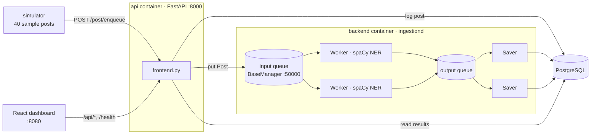
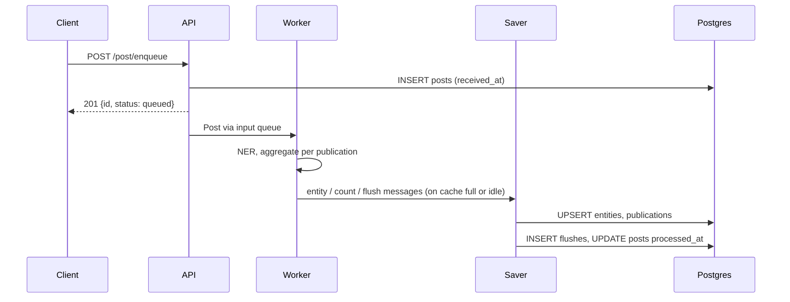

# Python Data Ingestion App

> A multi-process ingestion pipeline: posts arrive over HTTP, spaCy workers pull named entities out of them, and savers write the aggregated results to PostgreSQL. A React dashboard shows each run as it happens.


## 1. The problem

A stream of articles (posts) arrives from many publications. We want to know **which people, places and organisations each publication talks about**, without making the HTTP caller wait for NLP. We also want the work to spread across CPU cores.

## 2. The design



* **Front-end (`ingest/frontend.py`)** accepts a post, gives it an id, logs it in `posts`, and puts it on a remote multiprocessing queue. It returns at once.
* **Workers (`ingest/backend.py`)** run spaCy `en_core_web_sm`. They count entities per publication (dates, numbers and money are skipped), then **flush** an aggregate when their cache is full or the queue has been idle for `FLUSH_IDLE_SECONDS`.
* **Savers** upsert entity counts and article counts, record a `flushes` row (one *run*), and mark the posts processed.



## 3. Run it

```bash
cp .env.example .env      # optional; the defaults work
docker compose up --build
```

| Service | URL |
|---|---|
| Dashboard | http://localhost:8080 |
| API + Swagger | http://localhost:8000/docs |
| Postgres | localhost:5434 (ingest/ingest) |

The one-shot `simulator` sends 40 posts and exits. Send them again with `docker compose run --rm simulator`, or raise `SIM_REPEAT`. To post your own:

```bash
curl -X POST localhost:8000/post/enqueue -H 'Content-Type: application/json' \
  -d '{"publication":"Tech Ledger","title":"Hello","content":"Apple opened an office in Toronto."}'
```

There is **no auth** by default. Set `INGEST_API_KEY` to require an `access_token` header on enqueue.

## 4. What you see

The publications table and the entities chart are linked. Click a publication to filter the chart:


Each flush is one worker → saver batch, with its worker PID, post count and entity count. Each post shows its end-to-end latency. Full page: [dashboard-full.png](docs/screenshots/dashboard-full.png). API docs: [api-docs.png](docs/screenshots/api-docs.png). Raw responses: [api-samples.json](docs/screenshots/api-samples.json).

**Verified run:** 40 posts → 40 processed, 12 flushes whose post counts sum to 40, 0 posts left pending, 10 articles per publication.

### Data

`data/sample_posts.jsonl` holds 40 posts. The **text is real**: English Wikipedia intro extracts (CC BY-SA 4.0), fetched by `scripts/build_sample_posts.py`. The **publication names (Tech Ledger, World Dispatch, Science Weekly, Sports Wire) are made up** for the demo.

## 5. API

| Method | Path | Returns |
|---|---|---|
| POST | `/post/enqueue` | `{id, status}` (503 if the backend is down) |
| GET | `/health` | DB and queue status, post/processed/flush counts |
| GET | `/api/publications` | article count and distinct entities per publication |
| GET | `/api/entities?publication=&limit=` | top entities, overall or for one publication |
| GET | `/api/flushes` | recent flush runs |
| GET | `/api/posts` | recent posts with processing latency |

## 6. Bugs fixed along the way

| Original behaviour | Fix |
|---|---|
| `register_manager` passed a non-callable, so remote clients could not reach the queue | `callable=lambda: queue` |
| `e.label` (an int) was compared with label strings, so no entity type was ever skipped | `e.label_` |
| Entity doc ids used `hash(word)`, which is randomised per process | stable keys (the word; sha1 for Firestore) |
| The flush fired only when the *lifetime* count equalled the cache size (once) | pending counter plus an idle flush |
| `Worker.shutdown` used a nonexistent `self.outq` | STOP goes on the worker's input queue |
| `cpu_count() - 7` could be 0 or negative | `max(1, …)` |
| A successful enqueue returned the undefined `ex` (500) | returns `{id, status}` |
| Auth was hard-coded as `password` | optional `INGEST_API_KEY` |
| The DB client was created before fork and shared by the savers | one connection per saver, created in `run()` |
| fastapi 0.68 / spaCy 3.4 / pydantic v1 pins | spaCy 3.8, FastAPI current, pydantic v2, uv lock |

Firestore is still supported: set `DATA_STORAGE=firestore` and install the extra with `uv sync --extra firestore`. It needs Google credentials, so this PR has **not** run it.

## 7. Tests and CI

```bash
uv sync && uv run pytest -q     # 17 tests: models, worker flush/shutdown, spaCy NER, API, queue, shutdown watcher
```

GitHub Actions runs pytest, then the frontend build, then `docker compose build`.

## 8. Layout

```
ingest/       backend (workers/savers), frontend (API), models, persistence, config
simulator/    sends the sample posts
frontend/     React + Vite + TS, served by nginx (proxies /api and /health)
data/         sample posts
scripts/      sample-data builder, Playwright screenshots
docs/         original README, screenshots
legacy/       files moved aside (setup.py, supervisord.local.conf)
```
